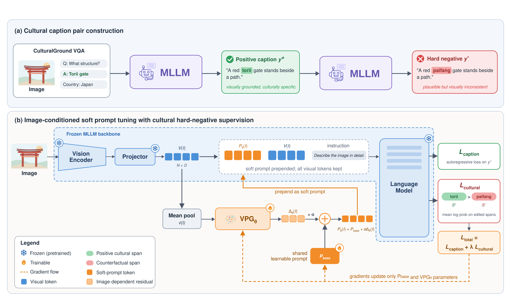

# CAPS: Culturally-Aware image captioning via image-conditioned soft Prompting and hard-negative Supervision

## Abstract
Multimodal large language models have substantially advanced image captioning, yet they still struggle to recognize and describe culturally specific visual content, particularly in underrepresented cultural contexts. We introduce CAPS, a parameter-efficient framework for culturally enriched image captioning. CAPS adapts a frozen multimodal backbone through a lightweight image-conditioned prompt generator that combines shared learnable prompt embeddings with an image-dependent component derived from visual representations. To provide targeted cultural supervision, we construct culturally enriched captions together with counterfactual hard negatives in which a single culturally meaningful detail is replaced by a plausible but visually inconsistent alternative. Training combines standard autoregressive captioning supervision with a localized ranking objective over the modified cultural spans, directing adaptation toward fine-grained cultural distinctions while leaving the pretrained backbone unchanged. Experiments on culturally diverse image captioning benchmarks show that CAPS improves both general caption quality and the representation of culturally relevant information compared with the untuned backbone and alternative parameter-efficient adaptation strategies. The proposed approach also retains efficient single-stage inference, avoiding the additional processing required by multi-agent or multi-stage cultural captioning pipelines.



## Installation

From the repository root, create and activate the Conda environment:

```bash
conda env create -f environment.yml
conda activate caps_env
```

Training uses a CUDA GPU and downloads the default LLaVA backbone (`llava-hf/llava-1.5-7b-hf`) from Hugging Face. Data generation also requires a running [Ollama](https://ollama.com/) server with the vision model configured in `utils/config.py` (or pass `--model` / `--ollama_model`).

## Data preparation

The datasets and images are not included. Download CulturalGROUND, place its JSON and images under `data/CulturalGROUND/`. Run these commands from the repository root; adjust paths to your files:

```bash
python -m data.generate_captions \
  --source-json data/CulturalGROUND/CulturalGround-OE-Filtered-14M.json \
  --images-root data \
  --output-dir data/positive_captions

python -m data.split \
  --input data/positive_captions/captioned \
  --output-dir data/positive_splits

python -m data.generate_negatives \
  --input_json data/positive_splits/train_sampled.json \
  --images_dir data \
  --output_json data/splits/train_sampled.json

python -m data.generate_negatives \
  --input_json data/positive_splits/val_sampled.json \
  --images_dir data \
  --output_json data/splits/val_sampled.json
```

The final split files contain the positive captions and generated `negative_caption` fields.

## Training CAPS

```bash
python -m CAPS.train \
  --data_dir data/splits \
  --images_dir data \
  --output_dir checkpoints/caps
```

The best prompt checkpoint is saved at `checkpoints/caps/best/image_conditioned_prompt.pt`.

## Evaluation

Provide a CVQA, GD-VCR, or GeoDE JSON/CSV (or Hugging Face `save_to_disk` directory) with image paths. Generate CAPS captions, for example on CVQA:

```bash
python -m eval.evaluate \
  --dataset cvqa \
  --method caps_cultural_loss \
  --stage generate \
  --input path/to/cvqa.json \
  --images-dir path/to/images \
  --checkpoint checkpoints/caps/best \
  --output results/cvqa_caps.json
```

For the LLM judge, add the human reference captions provided in `eval/human_metrics/HumanCaptions/` and run the judge with Ollama:

```bash
python -m eval.prepare_references \
  --dataset cvqa \
  --predictions results/cvqa_caps.json \
  --output results/cvqa_caps_references.json

python -m eval.evaluate \
  --dataset cvqa \
  --method caps_cultural_loss \
  --stage judge \
  --input results/cvqa_caps_references.json \
  --images-dir path/to/images \
  --output results/cvqa_caps_judged.json
```

Use the corresponding dataset name for GD-VCR (`gdvcr`) or GeoDE (`geode`). Automatic metrics additionally require LongCLIP and RAM tags.
